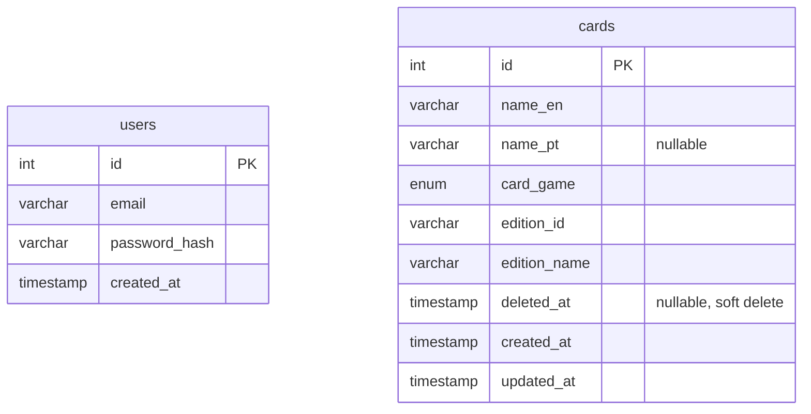

# TCG Card Manager (Backoffice)

An administrative portal for managing Magic: The Gathering, Pokémon, and Yu-Gi-Oh! cards, with login
authentication, full CRUD functionality, and an edition selector that depends on the chosen game. Built as
a technical challenge for a Full Stack hiring process, using plain PHP, MySQL, and vanilla JavaScript, with
no back-end or front-end frameworks.

## Branch strategy

This is the `theme/backoffice` branch. The `main` branch is the minimal, unstyled baseline: exactly what
the challenge asks for, functionally complete, with plain HTML and CSS and no visual theme applied. Theme
branches like this one build different visual
styles on top of this same functional base, as a portfolio exercise. The PHP API and `js/api.js` are the
same in every branch, only the pages, the CSS, and the rendering code in `js/dashboard.js` change.

| Branch | Style |
|---|---|
| `theme/gbc-style` | Inspired by the Game Boy and Game Boy Color TCG games (Pokémon Trading Card Game, Pokémon Card GB2, Yu-Gi-Oh! Dark Duel Stories), with switchable handheld palettes. |
| `theme/backoffice` | A plain, accessible admin panel built around the challenge's note about users with different levels of comfort with technology. |
| `theme/modern-tcg` | Inspired by current digital TCG platforms and collection apps (MTG Arena, Pokémon TCG Live, Yu-Gi-Oh! Master Duel), with a card grid and foil effects. |

This is a study and portfolio project, with no affiliation to the original brands.

## Theme: accessible backoffice

The challenge asks for a portal that works for users with different levels of comfort with technology.
This theme takes that as the main requirement and trades visual flair for clarity.

- **Larger by default.** Base text is 18px, and every button and field is at least 44px tall, which
  helps with low vision, shaky hands and touch screens.
- **Fields that explain themselves.** Each label says whether the field is required or optional, and
  short hints explain the less obvious parts, like leaving the Portuguese name blank or why the edition
  list starts disabled.
- **Clear feedback.** Saving, adding and deleting a card each show a confirmation message, announced to
  screen readers through `role="status"`. Errors use an icon and a border as well as color, so they do
  not rely on color alone. The login form shows its own message for empty fields and a "Show password"
  option, and the Save and Sign in buttons are disabled while a request runs, so a double click cannot
  send it twice.
- **Safer delete.** The browser's `confirm()` is replaced by a native `<dialog>` that names the card and
  has two explicit buttons, "Keep card" and "Delete card". "Keep card" has focus by default, and Esc
  cancels.
- **Keyboard and screen reader support.** There is a skip link, a focus ring visible on every
  background, `aria-label`s that include the card name on each row's Edit and Delete buttons, and focus
  moves to a sensible place after the form closes or a card is deleted.
- **Light and dark.** Colors are CSS variables with a dark set under `prefers-color-scheme`, both
  checked for WCAG AA contrast. No web fonts, the system font stack loads instantly.
- **Small screens.** The table turns into one block per card, with the column name above each value.
- **Every request shows its state.** A thin progress bar runs at the top of the page while any request is
  in flight, buttons switch to a spinner with a label that says what is happening ("Signing in...",
  "Saving...", "Deleting..."), the card list shows placeholder rows while it loads, and a "Still working"
  notice appears when the server takes more than 5 seconds. The delete dialog stays open until the
  server answers, so it never closes before anything happened.
- **Errors say what to do next.** A wrong password marks both fields and selects the password to type it
  again, with a Caps Lock warning next to the field. Form problems are listed in a summary at the top of
  the form, each one a link to its field. A list that fails to load, or editions that fail to load, show
  the reason and a "Try again" button instead of an empty table or a select stuck on "Loading".
- **Connection and session.** A banner appears while the browser is offline. If the session ends while
  the page is open, the user goes back to the sign in page with a message saying the session ended.
  The shared helpers for all of this live in `js/feedback.js`.

## Status

Functionally complete on this branch: login, full card CRUD, and the cascading edition select all work
end to end.

## Architecture Decisions

Key technical decisions made before implementation, and why.

- **Frontend: AJAX-first.** After login, the PHP back-end works as a pure JSON API (`api/*.php`), so
  listing, creating, editing, and deleting cards never reload the page. All rendering happens in vanilla
  JS, through `fetch` and direct DOM manipulation. This lines up with what the challenge actually
  evaluates: DOM manipulation skill, not just a form that posts to PHP and reloads.
- **Authentication: native PHP sessions.** Login uses `session_start()` and `$_SESSION['user_id']`, and
  calls `session_regenerate_id(true)` right after authenticating to prevent session fixation. Since the
  front-end and the API share the same origin, the session cookie is sent automatically with every
  `fetch`, so there's no need for a custom token layer. Both `dashboard.php` (server-side redirect if
  there's no session) and each `api/*.php` endpoint (401 if unauthenticated) check the session on their
  own.
- **User management: seed-only, no self-registration.** Test users come from `sql/seed.sql`. The
  challenge only asks for login, not account creation, and letting anyone sign up as an administrator
  wouldn't make sense for this kind of tool anyway.
- **Card deletion: soft delete.** Deleting a card sets a `deleted_at` timestamp instead of removing the
  row, and every listing query filters on `WHERE deleted_at IS NULL`. There's no trash or restore screen
  in this version, but the schema is ready for one later. The confirmation step before deleting stays
  either way, since from the user's point of view the card disappears the same way.
- **Editions data: static JSON, not a database table.** `data/editions.json` mirrors the exact dataset
  from the challenge, and `api/editions.php?game=<game>` serves it as a real HTTP request. Cards store
  `edition_id` and `edition_name` as plain columns, a snapshot taken when the card is saved, instead of a
  foreign key, since editions are a fixed external catalog rather than something managed through the
  portal.
- **Relative URLs and predictable errors.** Every URL the front end calls, and every redirect PHP sends,
  is relative, so the app also works from a subfolder or behind a proxy that adds a path prefix. The API
  always answers in the same `{ ok, error }` JSON shape, even for unexpected server errors, and
  `js/api.js` turns network failures, timeouts (15 seconds) and non-JSON answers into that same shape.
  The pages only ever check `body.ok`, so no request can leave the screen stuck without a message.
- **Environment: Docker Compose.** Running `docker-compose up` starts PHP (Apache) and MySQL together,
  and `sql/schema.sql` and `sql/seed.sql` load automatically on first boot. This was chosen for
  reproducibility, so no one needs PHP or MySQL installed locally to run or evaluate the project.

## Database Schema

No relationship line connects the two tables: cards are not tied to the user who created them in this
version, so `users` and `cards` are independent. Editions are not a table at all, see the "Editions data"
decision above.

## How to run

1. Copy `.env.example` to `.env`. The default values work fine for local development.
2. Run `docker-compose up -d --build`. This starts PHP, MySQL, and Adminer, and loads the schema and seed
   data automatically on first boot.
3. Visit `http://localhost:8080/login.html` and log in with the test credentials below.
4. Adminer, a database GUI, is available at `http://localhost:8081` if you want to inspect the database
   directly (server `db`, credentials from your `.env`).

## Test credentials

| Field | Value |
|---|---|
| Email | admin@admin |
| Password | password |

## UX Decisions

- **The card form opens as a dialog in front of the list.** Clicking "New card" or "Edit" on any row,
  even at the bottom of a long list, shows the form right where the user is looking, with no scrolling to
  find it. A native `<dialog>` opened with `showModal()` also keeps keyboard focus inside the form and
  closes with Esc, without extra code.
- **Confirming before deleting a card.** Deleting shows a confirmation prompt ("Delete '\<name\>'? This
  cannot be undone.") before the request goes out. The challenge asks to design for users with different
  levels of comfort with technology, and a destructive action with no undo screen in this version is
  exactly the kind of thing that benefits from a clear, hard-to-misclick confirmation step.
- **Showing "—" for a missing Portuguese name, instead of leaving the cell blank or repeating the English
  name.** An empty-looking cell can read as a loading glitch or a bug, and repeating the English name
  would misrepresent data that was never actually entered. A plain placeholder character makes it
  immediately clear, at a glance, that the field simply was not filled in for that card.
